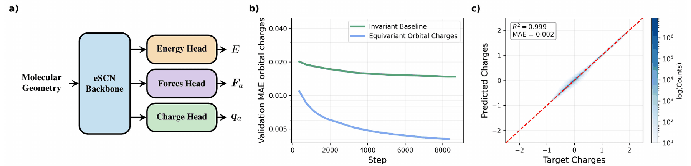
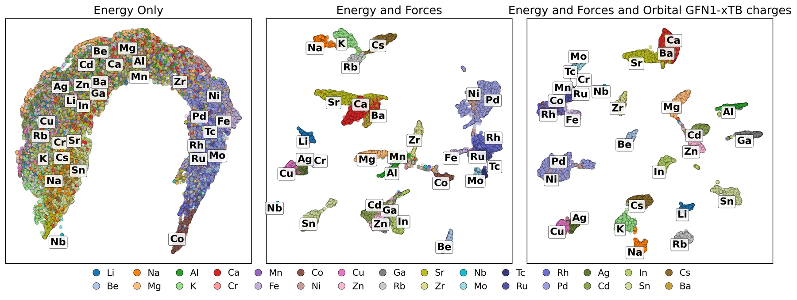

<div align="center">

# orbq-mlip

**Multitask learning with semiempirical orbital charges enables sample-efficient MLIPs**

[](https://openreview.net/forum?id=hSiJO1ssmO)
[](https://openreview.net/forum?id=6RA1r4UTXa)
[](https://www.python.org/)
[](LICENSE)

</div>

---

Machine learning interatomic potentials (MLIPs) need large, expensive DFT datasets.
**orbq** trains an equivariant MLIP to predict, alongside DFT energies and forces,
**orbitally resolved GFN1-xTB charges**. These are cheap to compute and scale linearly with system size. The extra electronic-structure task makes the potential markedly more data-efficient, and because the charge head is only
used during training, inference costs nothing extra.

<p align="center">
  
</p>
<p align="center"><sub><b>Fig. 1</b> (a) Shared eSCN backbone with energy, force and orbital-charge heads.
(b) The equivariant charge head, built from the transformation rules of orbital charges under rotation,
reaches a >4× lower error than an invariant head. (c) Parity of predicted vs. GFN1-xTB orbital charges.</sub></p>

## Highlights

On neutral organometallic complexes from OMol25:

- **58 %** lower energy error vs. energy-only training and **12 %** lower vs. energy + forces.
- **5× less data** to reach the accuracy of the energy-only baseline.
- Cheap semiempirical **orbital** charges match or beat expensive **DFT atomic** charges at every dataset size.
- The learned latent space spontaneously clusters chemically similar metals (Ag/Cu, Zn/Cd, Ca/Ba, Ni/Pd).

<p align="center">
  
</p>

## Installation

```bash
git clone https://github.com/ineporozhnii/orbq-mlip.git
cd orbq-mlip

# 1. PyTorch for your CUDA version, see https://pytorch.org (CPU works for testing)
pip install torch

# 2. orbq (editable) with the data-generation and analysis extras
pip install -e ".[datagen,analysis]"
```

Or use conda with `conda env create -f environment.yml`. Requirements: Python ≥ 3.10,
PyTorch ≥ 2.1 and Lightning ≥ 2.6. Run the tests with `pip install -e ".[dev]" && pytest`.

## Data generation

The pipeline turns OMol25 structures into a graph dataset with DFT energies, forces and
Mulliken/Löwdin charges plus GFN1-xTB orbital and atomic charges.

```bash
OUT=/path/to/orbq_data

# 1. neutral singlet metal complexes from the OMol25 4M training split
orbq-datagen extract --omol-path /path/to/OMol25/train_4M --out-dir $OUT/extracted

# 2. GFN1-xTB charges with dxtb, once per SCF convergence target
for mode in charge potential fock; do
  orbq-datagen dxtb --input-dir $OUT/extracted --output-dir $OUT/gfn1_$mode --scp-mode $mode
done

# 3. keep structures whose orbital charges agree across the three modes, drop 5σ outliers,
#    create nested splits, fit the per-element energy reference, pack the dataset
orbq-datagen prepare --charge-dir $OUT/gfn1_charge --potential-dir $OUT/gfn1_potential \
    --fock-dir $OUT/gfn1_fock --out-dir $OUT \
    --train-sizes 1000 3000 10000 30000 100000   # paper setting, see below

# 4. radius graphs (5 Å) into LMDB
orbq-datagen preprocess --tar --data_path $OUT/tar --out_path $OUT/lmdb
```

## Training

Point the data config at the pipeline output, for example in a `.env` file (see `.env.example`):

```bash
export ORBQ_DATA_DIR=/path/to/orbq_data
```

Train one model, one setting at a time:

```bash
orbq-train model=energy_forces_charges_orbital_dxtb data.train_size=100000 train.seed=0
```

The settings from the paper (`model=`) are:

| `model=` | Targets |
|---|---|
| `energy` | DFT energy |
| `energy_forces` | DFT energy + forces |
| `energy_forces_charges_orbital_dxtb` | + GFN1-xTB orbital charges (**ours**) |
| `energy_forces_charges_atomic_dxtb` | + GFN1-xTB atomic charges |
| `energy_forces_charges_atomic_lowdin` | + DFT Löwdin atomic charges |
| `energy_forces_charges_atomic_mulliken` | + DFT Mulliken atomic charges |

Loss weights, training length and learning-rate schedule are set per `data.train_size`
(3000, 10000, 30000, 100000) to the values used in the paper; see `orbq/config/model/*.yaml`
and `orbq/config/train/default.yaml`. Each run trains on one GPU, and checkpoints go to `runs/<setting>_<size>_seed<seed>/`.
Logging uses Weights & Biases in offline mode by default (`train.logging.wandb.mode=online|disabled`).

## Evaluation

```bash
orbq-test --ckpt_path runs/energy_forces_charges_orbital_dxtb_100000_seed0 \
    --data_path $ORBQ_DATA_DIR/lmdb --split_file $ORBQ_DATA_DIR/splits/datasplits_100000.json \
    [--save_emb]
```

This writes the predictions and targets (energies, charges, forces, and optionally atomic
embeddings) to `test_<charges_type>_results.pt` in the run directory.

## Reproducing the paper

| Result | How |
|---|---|
| Fig. 1b: equivariant vs. invariant charge head | `orbq-train experiment=fig1b_equivariant data.train_size=100000` and `experiment=fig1b_invariant` |
| Fig. 2: scaling, energy and force MAE | the six `model=` settings × `data.train_size=3000,10000,30000,100000` × `train.seed=0,1,2` (e.g. `orbq-train -m model=... data.train_size=3000,10000,30000,100000 train.seed=0,1,2`) |
| Figs. 3, 5: UMAP of metal embeddings | `orbq-test ... --save_emb`, then `python analysis/plot_umap.py --panel "<title>" <results.pt> ...` |
| Fig. 6: dxtb timings | `python analysis/plot_calc_times.py --tar $ORBQ_DATA_DIR/tar/dataset.tar` |
| Table 1: energy reference | written by `orbq-datagen prepare` to `$ORBQ_DATA_DIR/energy_coefficients.json` |

## Repository structure

```
orbq/
├── config/        Hydra configs: data/, model/ (six settings + backbones), train/, experiment/
├── data/          AtomicData graphs, LMDB dataset, Lightning DataModule
├── datagen/       data pipeline: extract, dxtb, prepare, preprocess (orbq-datagen)
├── model/         MultitaskLightningModule, eSCN backbone with energy/force/charge heads,
│                  GFN1-xTB basis set (orbital layout of the charge head)
├── scripts/       train.py (orbq-train), test.py (orbq-test)
└── common/        utilities and a trimmed copy of PyTorch Geometric
analysis/          figure scripts
tests/             
```

## Citation

If you use this code, please cite:

```bibtex
@misc{neporozhnii2026multitasklearningsemiempiricalorbital,
      title={Multitask learning with semiempirical orbital charges enables sample-efficient MLIPs}, 
      author={Ihor Neporozhnii and Sjoerd Hoogland and Oleksandr Voznyy},
      year={2026},
      eprint={2605.24073},
      archivePrefix={arXiv},
      primaryClass={physics.chem-ph},
      url={https://arxiv.org/abs/2605.24073}, 
}
```

## License

Apache License 2.0, see [LICENSE](LICENSE). Third-party code and data are listed in
[THIRD_PARTY_NOTICES.md](THIRD_PARTY_NOTICES.md).
